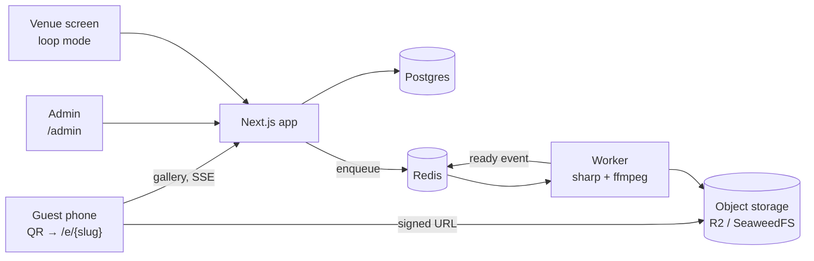
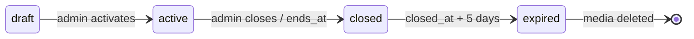

<div align="center">

<picture>
  <source media="(prefers-color-scheme: dark)" srcset=".github/assets/logo-dark.png">
  
</picture>

### Guest photos and videos, live on the big screen.

**Guests scan the QR code on their table, share photos and videos in original quality, and watch them play in a loop on the venue screen.**

[](https://github.com/Castro-arch/kokka/actions/workflows/ci.yml)


[Quick start](#quick-start) · [How it works](#how-it-works) · [Features](#features) · [Stack](#tech-stack) · [Project structure](#project-structure) · [Roadmap](#roadmap) · [Contributing](CONTRIBUTING.md)

</div>

> [!IMPORTANT]
> Kokka is proprietary software built for a single client. This repository is private; do not redistribute code, assets or credentials. See [LICENSE](LICENSE).

## Quick start

**Requirements:** Node 22 LTS, pnpm, Docker with Compose.

```bash
pnpm install
cp .env.example .env          # local defaults; never commit .env
pnpm services:up              # Postgres, Redis and S3 storage (SeaweedFS)
pnpm db:migrate
pnpm db:seed-admin            # creates the admin from ADMIN_EMAIL / ADMIN_PASSWORD
pnpm dev:web
```

Open `http://localhost:3000/admin` and sign in with the credentials from your `.env`.

**Testing the QR code on a phone:** set `APP_URL` to your machine's LAN address (e.g. `http://192.168.0.10:3000`), run the dev server bound to the network, and connect the phone to the same Wi-Fi.

## How it works



1. The admin creates an event, customizes it and prints the A6 table card with its QR code.
2. Guests open the gallery without signing in and upload **originals** straight to storage through signed, resumable uploads.
3. The worker generates thumbnails and playback versions; the original is never modified.
4. Galleries and the venue screen update in real time over SSE.
5. When the event closes, uploads stop and everything stays available for download for **5 days**, then it is deleted.

### Event lifecycle



## Features

| Area | What it does | Status |
|---|---|---|
| Admin | Email/password sign-in, server-side session guard | ✅ v0.2.0 |
| Events | Create, edit, forward-only status (draft → active → closed) | ✅ v0.2.0 |
| Branding | Primary color, 5 curated fonts, cover photo (auto-rotated, EXIF stripped) | ✅ v0.2.0 |
| Print | QR code and 300 dpi A6 table card (PNG) | ✅ v0.2.0 |
| Guest gallery | Browse, take or upload photos and videos, resumable uploads | 🔜 Step 3 |
| Processing | Thumbnails, HEIC → JPEG, 720p MP4, original always kept | 🔜 Step 4 |
| Venue screen | Full-screen loop, preload, offline-tolerant, hide/delete in real time | 🔜 Step 5 |
| Lifecycle | 5-day retention, ZIP export, automatic cleanup, database backups | 🔜 Step 6 |

## Tech stack

| Layer | Choice |
|---|---|
| Web | Next.js (App Router), Server Actions for admin mutations, Route Handlers for files, SSE and guest endpoints |
| Data | PostgreSQL + Drizzle ORM |
| Queue & realtime | Redis, BullMQ, pub/sub |
| Storage | Cloudflare R2 in production, SeaweedFS locally (S3 API) |
| Media | sharp, ffmpeg |
| Auth | Better Auth (email + password, no public sign-up) |
| UI | Tailwind CSS |
| Tooling | pnpm workspaces, TypeScript strict, ESLint, Prettier, Vitest, commitlint, husky, Changesets |
| Deploy | Docker Compose on a VPS via Coolify |

## Project structure

| Path | Package | Purpose |
|---|---|---|
| `apps/web` | `@kokka/web` | Admin panel, guest gallery, venue screen and API |
| `apps/worker` | `@kokka/worker` | Media processing, exports and lifecycle jobs |
| `packages/db` | `@kokka/db` | Drizzle schema, migrations and queries |
| `packages/shared` | `@kokka/shared` | Schemas, env validation, storage client, shared utilities |

## Development workflow

- **Commits:** [Conventional Commits](https://www.conventionalcommits.org/) in English, atomic, enforced by commitlint.
- **Branches:** trunk-based; short-lived `feat/*`, `fix/*`, `chore/*` branches merged with **rebase and merge**.
- **Releases:** SemVer with Changesets; every roadmap step ships as a minor release and a `vX.Y.Z` tag.
- **Quality gates:** lint-staged on commit, typecheck and tests on push, full CI on every pull request.

Details in [CONTRIBUTING.md](CONTRIBUTING.md).

## Roadmap

- [x] **v0.1.0** — Foundation: monorepo, database, Docker, CI
- [x] **v0.2.0** — Admin: events, branding, QR code and print card
- [ ] **v0.3.0** — Guest gallery and uploads
- [ ] **v0.4.0** — Media processing worker
- [ ] **v0.5.0** — Venue screen and moderation
- [ ] **v0.6.0** — Lifecycle, ZIP export and backups
- [ ] **v0.7.0** — Real-device and load testing
- [ ] **v1.0.0** — First live event

## FAQ

**Do guests need an account or an app?**
No. They scan the QR code and use the browser on any phone.

**Are photos and videos compressed?**
The original file is always stored untouched and available for download. Lighter versions are generated only for browsing and playback.

**How long is content kept?**
Uploads close when the event ends; everything remains available for 5 days and is then permanently deleted.

## Security

Please report vulnerabilities privately as described in [SECURITY.md](SECURITY.md). Never open a public issue for security problems.

## License

Proprietary. © 2026 José Arthur de Castro Tavares. All rights reserved. See [LICENSE](LICENSE).

<div align="center">
  <br>
  
</div>
